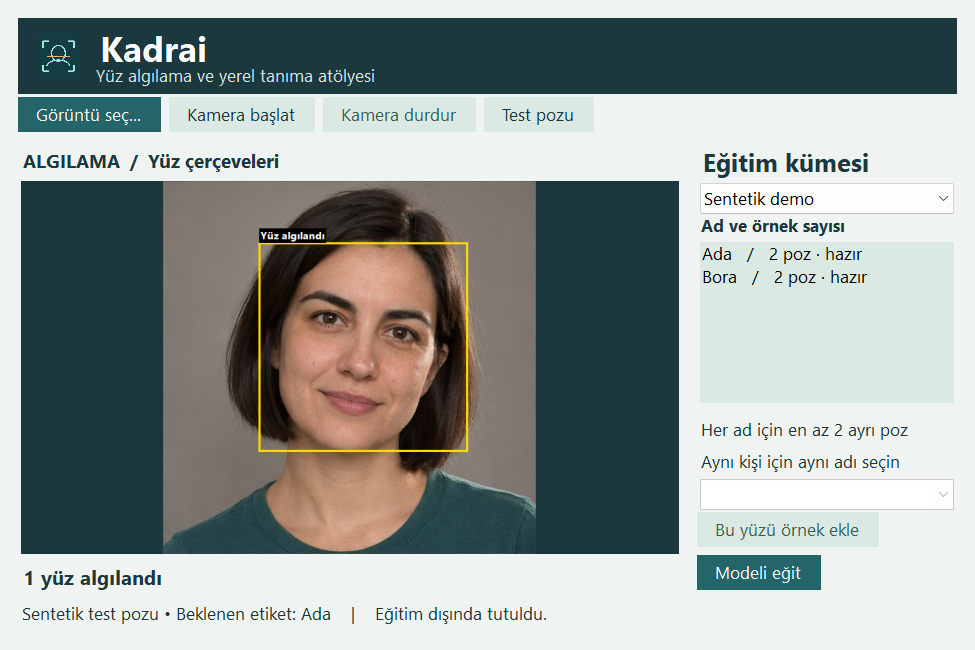
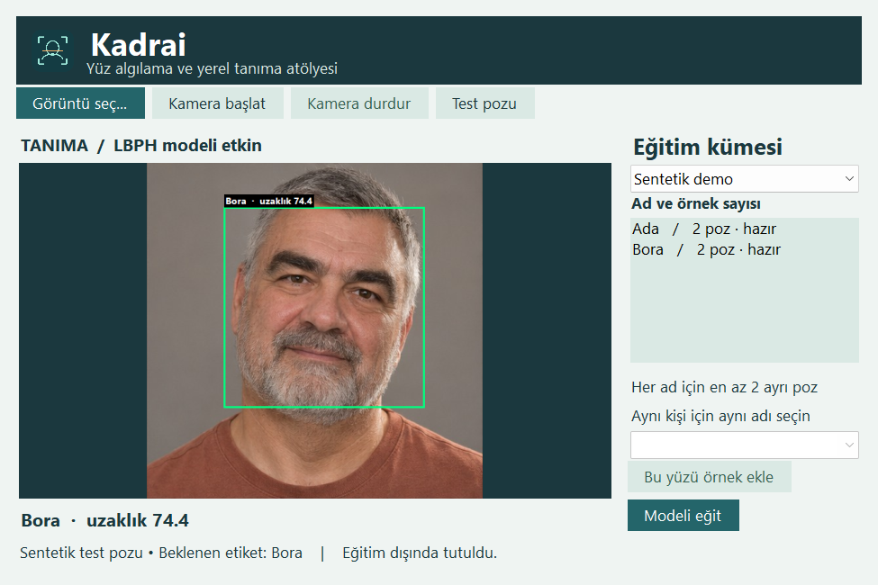

# Kadraj · OpenCV ile Yüz Tanıma

Bir görüntüde yüzün **nerede** olduğunu algılayan ve küçük bir örnek kümesiyle eğitildikten sonra **hangi etikete benzediğini** gösteren OpenCV atölyesi. Açılışta görülen iki kurgusal kişinin portreleri bu proje için üretildi.

**Ahmed Kannavi** · Öğrenci no. **240541603** · YMH219 Nesne Tabanlı Programlama

## Kullanılan teknolojiler

C#, .NET 10, Windows Forms ve OpenCvSharp4.Windows 4.13.0.20261107. Haar CascadeClassifier ile algılama, LBPHFaceRecognizer ile tanıma yapılır.

## Kurulum ve çalıştırma

Windows 10/11 x64 üzerinde Git ve [.NET 10 SDK](https://dotnet.microsoft.com/download/dotnet/10.0) kurulu olmalıdır. PowerShell'de aşağıdaki komutları sırayla çalıştırın.

```powershell
git clone https://github.com/Ahmetkannavi/YMH219-FaceRecognition.git
cd YMH219-FaceRecognition
dotnet restore .\FaceRecognition.csproj
dotnet run --project .\FaceRecognition.csproj -c Release
```

Visual Studio'da **.NET masaüstü geliştirme** iş yükü ve .NET 10 desteğiyle `FaceRecognition.csproj` dosyasını açıp **F5** tuşuna basabilirsiniz.

## Algılama ve tanıma

1. **Sentetik demo** açıldığında bir test pozu görünür. Sarı çerçeve ile **ALGILAMA** başlığını kontrol edin.
2. Listede Ada ve Bora için ikişer ayrı eğitim pozu hazırdır. **Modeli eğit** düğmesine basın. **TANIMA** başlığı, yeşil çerçeve, tahmin edilen ad ve LBPH uzaklığı görünür.
3. **Test pozu** iki kurgusal kişinin eğitim dışı üçüncü pozları arasında geçer. **Görüntü seç…** kendi dosyanızı açar. **Kamera başlat / Kamera durdur** varsayılan kameranın canlı önizlemesini yönetir.

## Gönüllü örnekleri bir ad altında toplama

1. **Kişisel yerel küme** seçin. Bir gönüllünün tek yüz içeren fotoğrafını açın veya kamerayı başlatın.
2. Ad alanına bir etiket yazıp **Bu yüzü örnek ekle** düğmesine basın. Yeni açıda ikinci bir kare seçip aynı adı kullanın. Var olan kişi, açılır listeden seçilebilir.
3. İkinci gönüllü için tekrarlayın. Liste her adın örnek sayısını ve eksik poz sayısını gösterir. İki adın her birinde en az iki örnek olduğunda eğitim açılır. Eğitimden sonra yeni bir örnek eklemek, yeniden eğitim gerektirir.
4. Modeli eğitip veri eklerken kullanmadığınız farklı bir resim seçin. Mesafe küçüldükçe eşleşme yakınlaşır. Uzaklık 78’i aştığında uygulama **Bilinmiyor** gösterir.

## Veri ve sınıf tasarımı

`SampleLibrary` kişisel örnekleri `%LOCALAPPDATA%\YMH219\Kadraj\Ornekler` altında ad bazında gruplar. Kaydedilen veri 128 × 128 gri yüz kesitidir. Aynı kesitin ikinci kez eklenmesi engellenir. Eğitimli model oturum belleğindedir. `FaceStudio` Haar kaskadıyla yüzleri bulur, kesitleri normalize eder ve LBPH modelini eğitir. `MainForm` kamera, dosya ve durum göstergesini yönetir.

`Assets/Demo/Egitim` yalnızca dört eğitim portresini, `Assets/Demo/Test` iki ayrı test portresini içerir. Altı portre bu ders demosu için yapay olarak üretildi. Ekran görüntülerinde bu sentetik örnekler kullanıldı. Algılama verisinin lisans metni XML dosyasının başındadır. [OpenCV Haar kaskadı](https://github.com/opencv/opencv/blob/4.12.0/data/haarcascades/haarcascade_frontalface_default.xml)

## Testler ve sınırlamalar

İlk açılışta tek yüz algılandı. Eğitimden sonra model ayrı tutulan Ada ve Bora pozlarını sırasıyla **72,1** ve **74,4** LBPH uzaklığıyla doğru etiketledi. Cihaz kamerası açılıp durduruldu. Boş kişisel kümede eksik etiket sayısı görüldü ve eğitim düğmesi kapalıydı.

Uzaklık bir olasılık yüzdesi değildir. İki sentetik kişiyle yapılan çalışma bir ders gösterimidir. Işık, açı ve yüz sayısı sonucu etkiler. Kişisel veriyi yalnızca gönüllünün izniyle ekleyin. Kişisel küme akışı da sentetik dosyalarla denendi. Aynı ad altında iki poz toplandı, yinelenen kare reddedildi ve ayrı test pozu doğru etiketlendi.

## Ekran görüntüleri





